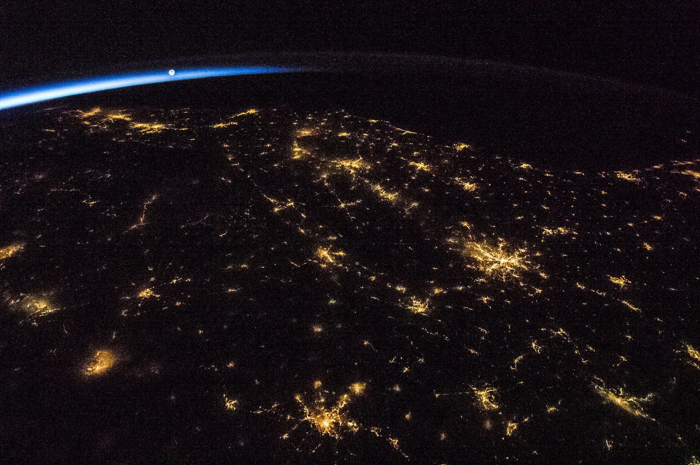

# Fifty Years Beyond Earth (1975–2026+)

An Awwwards-caliber scroll-driven narrative web experience documenting humanity's greatest space exploration achievements from the 1975 Apollo–Soyuz orbital handshake to present-day interstellar frontiers.



## Overview

- **29 Verified Milestones across 7 Chapters**: Apollo–Soyuz (1975), Viking 1 & 2 (1976), Voyager 1 & 2 (1977), STS-1 Columbia (1981), Mir (1986), Giotto (1986), Hubble launch (1990) & repair (1993), Mars Pathfinder (1997), ISS assembly (1998–2011), Spirit & Opportunity (2004), Cassini–Huygens (2004–2005), Kepler (2009), Voyager 1 heliopause crossing (2012), Rosetta & Philae (2014), New Horizons Pluto flyby (2015), LIGO gravitational waves (2015), Falcon 9 booster landing (2015), Hayabusa2 & OSIRIS-REx (2018–2020), Chang'e 4 far side landing (2019), EHT M87* black hole image (2019), SpaceX Demo-2 (2020), Perseverance & Ingenuity (2021), JWST first science (2022), DART kinetic deflection (2022), Artemis I (2022), the 6,445+ Exoplanet Census, Europa Clipper & Ocean Worlds (2024+), and the 2075 Voyager Centennial Horizon.
- **100% Procedural & Real Archival Visuals**:
  - Photorealistic 3-layer Earth (NASA Visible Earth Blue Marble day map + Black Marble VIIRS night lights + MODIS clouds) with a feathered Rayleigh horizon atmosphere shader.
  - Interactive 3D Saturn & Cassini Set Piece with real Cassini cylindrical mosaics, 4-channel ring radial optical depth textures, analytical cylindrical shadow casting, Titan photochemical haze, and Enceladus cryo-plume jets.
  - Draggable 3D Exoplanet Orrery simulating TRAPPIST-1, Kepler-90, 51 Pegasi, and the inner Solar System with Laplace resonance detection and synthetic JWST transmission spectra.
  - The Finale ("The Pull-Back"): Continuous 9-order-of-magnitude logarithmic zoom from the Heliosphere outward to the Oort Cloud, Local Stellar Neighborhood, Orion Arm, and full ESA Gaia / NASA SVS Milky Way panorama with "You are here" Sun + Voyager 1 & 2 markers.
- **Live Telemetry & Scrollytelling**:
  - Real-time Voyager 1 odometer ticking at 16.9995 km/s (+1.02 km per tick) with Deep Space Network signal attenuation (dBm) and Pu-238 RTG electrical wattage.
  - "Quiet Space Documentary" editorial art direction: `#050607` true void, `#E8E6E1` off-white, `#C89B57` warm amber accent, Fraunces serif display titles, Inter body prose, and JetBrains Mono telemetry numerals.
  - Responsive down to 390px mobile viewports with lightweight static archival plates and on-demand interactive WebGL.

## Quickstart

```bash
# Clone the repository
git clone git@github.com:IsaTippens/fifty-years-beyond-earth.git
cd fifty-years-beyond-earth

# Install dependencies
npm install

# Start local development server
npm run dev
```

Open `http://localhost:5173` to explore the chronicle.

## Project Structure

```text
fifty-years-beyond-earth/
├── src/
│   ├── lib/
│   │   ├── components/       # Scrollytelling chapters, HUD, timeline, Finale pull-back
│   │   ├── data/             # Verified mission telemetry, exoplanets, and asset manifests
│   │   ├── shaders/          # Custom GLSL Rayleigh atmosphere, nebula, and Saturn rings
│   │   ├── stores/           # Reactive scroll telemetry and live Voyager ticker
│   │   ├── styles/           # Design tokens (tokens.css)
│   │   └── three/            # WebGL starfield, Saturn Cassini scene, Exoplanet orrery
│   ├── routes/               # SvelteKit root layout and scrollytelling page
│   └── app.css               # Editorial type system and dark documentary styling
├── static/assets/            # 57 local archival plates & 3D textures in AVIF/WebP
├── ASSETS.md                 # Complete provenance and credit line for every image asset
├── SOURCES.md                # 95 primary citations cross-referenced to NASA, ESA, JPL, etc.
├── package.json
├── svelte.config.js
├── tsconfig.json
└── vite.config.ts
```

## Archival Data & Citations

- `SOURCES.md`: 95 primary citations from NASA, NASA JPL, ESA, JAXA, CNSA, Roscosmos, Caltech/IPAC, STScI, LIGO, EHT/ESO, JHUAPL, and SpaceX.
- `ASSETS.md`: Provenance, NASA/JPL/ESA photojournal IDs, licenses (Public Domain / CC BY 4.0), and attribution credits for all 57 photography and texture assets.

## License

MIT License. Archival photographs and planetary textures are public domain (NASA/JPL-Caltech/ESA/STScI) or CC BY 4.0 as credited in `ASSETS.md`.
